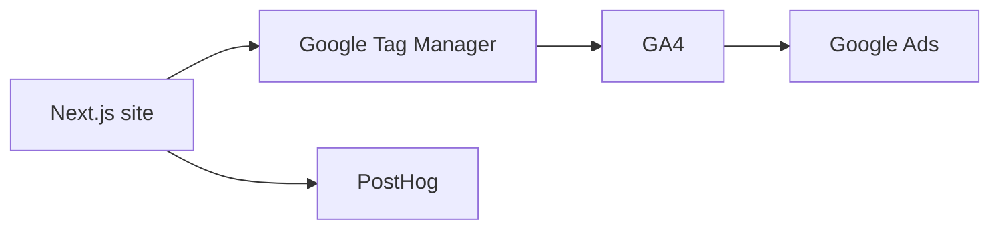

# Analytics plan reference

Agreed on 1 November 2026. This is the reference for new chats through at least 30 January 2027, and through day 90 after tracking goes live if that date is later.

How to use this file:

- "Give me details for step N" means expand that step below. Keep the decisions. Do not swap the architecture.
- "Elaborate on goals" means use the Goals, hypotheses, and Objectives sections.
- "Let's discuss our scope" means use the Scope section. Stay inside it unless the user changes it.
- The three buying statements are hypotheses. They are not findings until day 90 marks them confirmed, rejected, or inconclusive.
- Status on 1 November 2026: no account is created, no IDs have been sent, and the site has no analytics code.

Google tags load only through Google Tag Manager. GA4 and Google Ads are configured inside that container. PostHog is installed in the Next.js app with its official SDK so page changes on this site are recorded. There is no analytics code on the site today.

The pages are Home, About, Products, Factory, Quality, and Contact. The lead actions already in the site are the contact form submit in `components/contact-form.tsx`, plus the phone and email links in `components/footer.tsx` and `components/contact-page.tsx`.

Use one company Google account for GA4, Tag Manager, and Google Ads.

## Business requirements

Saudi Albandari Industrial Company sells laminate food packaging to food manufacturers and retail brands. The website does not close the order. It either starts a sale the sales team can quote now, or it puts Albandari on a buyer’s list for a later tender: the main vendor, a strong alternative, or the backup if the current supplier fails. Those are two different sales, and they need different measurements.

A short-cycle sale is a buyer who already has a spec, a new line, or a problem with their current film. They submit the form or call. The form opens their mail app, so the measurable action is the submit click. Revenue depends on a fast quote.

A long-cycle sale is a buyer who already has a supplier. They read the site to decide whether Albandari can replace that supplier, sit beside them, or be the name they call when something goes wrong. They often leave without asking. The order, if it comes, comes on a later visit. The website’s job in that sale is to be remembered as a credible plant, not to collect a lead on the first click.

The site can see the inquiry and the visits that led to it. It cannot see the riyal until sales writes down what happened to each inquiry. Analytics is there so that log can be trusted, and so ad spend can be judged against orders rather than clicks.

Which click, which page, and which visit belong to which sale is not known yet. The statements below are hypotheses. A goal of this measurement is to verify them.

### Goals

**Short-cycle sales.** Turn buyers who need packaging now into quotes and orders.

For the first 90 days after tracking is live, every form submit and phone click is handed to sales the same week. Sales records, for each one, whether it became a quote, an order, or a dead lead. Google Ads is allowed to spend only after `generate_lead` is the primary conversion. For those 90 days, each campaign is judged by cost per form-submit. As soon as the log has orders, the same campaigns are judged by cost per order. A campaign that buys clicks and no quotes is stopped.

**Long-cycle sales.** Be the vendor a buyer already trusts when they next change supplier, add a second source, or need a backup.

For the same 90 days, keep every inquiry, including email clicks, with the visits that came before it. The commercial aim is the later order. Whether a later visit, or a reading of Factory and Quality, is what produces that order is the hypothesis in the next goal, not an assumption of this one.

**Verify the buying hypotheses.** By day 90, mark each hypothesis confirmed, rejected, or inconclusive. Use the sales log together with GA4 and PostHog. A hypothesis is confirmed only when the inquiry outcome agrees with the visit pattern. A hypothesis the data rejects is dropped, and bidding and content follow the pattern that actually preceded quotes and orders.

- **Inquiry type.** Hypothesis: a form submit and a phone click are buyers who can order soon, and an email click is someone filing the address for later. Compare the three on the same clock: share that became a quote within 14 days, share that became an order within 90 days, and share still marked "not now" at day 90. The insight is which action predicts a near-term order and which action predicts a buyer who is only keeping the company on file. If email reaches a quote as often as the form, the hypothesis is rejected and email is added to the Ads conversion set.
- **Path.** Hypothesis: a contact on the first visit is the short sale, and a contact weeks later, after Factory or Quality, is the long sale. For every inquiry that became a quote or an order, record whether it happened on the first visit or a later one, and which pages were opened on the earlier visits. The insight is whether the order was earned by those earlier pages or belongs to the visit on the day they wrote. If first-visit and later-visit inquiries close at the same rate and read the same pages, the hypothesis is rejected, and the ad on the day of the inquiry keeps the credit.
- **Page.** Hypothesis: a short-cycle buyer lands and contacts, while a long-cycle buyer opens Factory and Quality before risking a switch. Group won inquiries by how fast they closed, and list the pages opened before the ask. The insight is which pages sit in front of a fast order and which pages sit in front of a later one. The pages that precede won orders are the ones to change next. A busy page that never precedes an order is not one of them.

### What the measurements are for

Each measurement exists to produce one of the insights above, or to price the ads. The numbers are kept separate so the comparison can be made. Combining them first would make the hypothesis impossible to check.

- **Form, phone, and email, kept as separate counts,** so the inquiry-type hypothesis can be scored against quotes and orders.
- **Page path, including Products, Factory, and Quality,** so the page hypothesis can be scored against which pages were open before a won inquiry.
- **First visit versus a later visit,** so the path hypothesis can be scored, and so a later order can be tied to the earlier visit when the data says the earlier visit earned it.
- **Language (`ar` or `en`),** so the same three comparisons can be read for each buyer group. The insight is whether the confirmed pattern is the same in both languages or only in one.
- **Campaign, ad group, and keyword,** so cost per quote and cost per order can be tied to the ad. When the path hypothesis is confirmed, that cost uses the ad from the earlier visit. When it is rejected, the cost uses the ad from the day of the inquiry.
- **Names, emails, and phone numbers stay out of GA4, Google Ads, and PostHog.** The sales inbox and the sales log hold the person. Analytics holds the count, the source, the page, and the language, so the comparisons above stay clean enough to accept or reject.

### Objectives

- By the end of the first live week, a test form submit and a test phone click appear once each in GA4 and PostHog, and `generate_lead` is imported in Google Ads as the primary conversion. No campaign spends before that test is seen.
- From that week through day 90, sales keeps a log of website inquiries with five fields: date, type (form, phone, or email), language, page, and source (campaign name, or organic/direct). Each row is updated to quote, order, or not now.
- At day 30, report cost per `generate_lead` for any live campaign. At day 90, report cost per order for every inquiry the log marked as an order. Campaigns with spend and no quotes are paused.
- At day 90, score the three hypotheses. Publish the quote rate and order rate for form, phone, and email; the same rates for first-visit inquiries and later-visit inquiries; and the pages opened before each won inquiry. Mark each hypothesis confirmed, rejected, or inconclusive, and state the bidding and content change that follows from the result.
- At day 90, repeat that score for Arabic and English. A pattern that holds in only one language is applied only to that language.
- Every week, the GA4 count of `generate_lead` matches the number of form rows in the sales log. A gap means the measurement is not clean enough to judge ad spend, and spend waits until the gap is explained.

### Scope

In scope: the public marketing site, the six pages above, the contact form, the phone links, and the email links in the footer and on the contact page.

Out of scope for this setup: creating ad campaigns, billing, a new form backend, a cookie banner, and tracking staff inside the factory or office. A later pass can filter the company’s own IP once the account is receiving real traffic.

### Requirements

- The site loads Google Tag Manager on every page from `app/layout.tsx`. GA4 and Google Ads tags are configured inside that container.
- The site loads the PostHog SDK and records a page view on each route change.
- Language (`ar` or `en`) is attached to page views and to the three lead events.
- Submitting the contact form pushes `generate_lead`. Clicking a `tel:` link pushes `click_phone`. Clicking a `mailto:` link pushes `click_email`.
- Each of those events is pushed to Tag Manager’s data layer and to PostHog.
- GA4 Measurement ID, Tag Manager container ID, and PostHog key and host are supplied by the business. The Measurement ID is entered in Tag Manager. The other three values are environment variables: `NEXT_PUBLIC_GTM_ID`, `NEXT_PUBLIC_POSTHOG_KEY`, `NEXT_PUBLIC_POSTHOG_HOST`.
- GA4 property timezone is Riyadh and currency is SAR. Google Ads country is Saudi Arabia, timezone Riyadh, currency SAR. PostHog project region is EU, host `https://eu.i.posthog.com`.
- GA4 and Google Ads are linked, and Ads auto-tagging is on, before campaigns launch.
- `generate_lead` and `click_phone` are GA4 key events and are imported into Google Ads. `click_email` remains a measured event and is not an Ads conversion until day 90 says otherwise.
- PostHog session replay stays on, with input masking for the contact form.
- Tags load after the page can render. A missing or empty ID leaves the site working and sends nothing.

### Business rules

- One company Google account owns GA4, Tag Manager, and Google Ads.
- Tag Manager is the only Google script on the site. GA4 and Ads are tags inside the container.
- `generate_lead` starts as the primary Ads conversion so the account has one bid target on day one. `click_phone` starts as the secondary conversion. `click_email` is measured and left out of Ads bidding until day 90. These are starting settings, not findings. Day 90 keeps or changes them according to which inquiry type actually became quotes and orders.
- A conversion counts once per click.
- Event payloads carry the action name, the page path, and the language. They do not carry the visitor’s name, email address, phone number, company, or message. The sales inbox and the sales log are the only places those details are stored.
- One action has one event name in both GA4 and PostHog. The weekly form-submit count in GA4 is the same number as new form rows in the sales log. A mismatch is fixed before any ad spend is judged from the reports.
- Contact-form values are masked in PostHog session replay. Replay is for seeing which page a buyer used, not for reading what they typed.
- Arabic and English are one website. Language is a property on the event, not a separate property or container.
- The Tag Manager container is published only after the snippet is on the site being tested.
- Google Ads campaigns start only after `generate_lead` is imported as a primary conversion and a test submit has been seen in GA4 DebugView.
- PostHog stays on the EU cloud for this project. The region is not changed later.

## 1. Create the GA4 property

1. Open [analytics.google.com](https://analytics.google.com) and sign in with the company Google account.
2. Click Admin (gear, bottom left) → Create → Property.
3. Property name: `Saudi Albandari`. Timezone: `(GMT+03:00) Riyadh`. Currency: `Saudi riyal (SAR)`.
4. Choose the business size and skip the business objectives if you want.
5. Choose platform **Web**.
6. Website URL: the live domain (`https://www.SaudiAlbandari.com` once it is the public site). Stream name: `Albandari website`.
7. Open Admin → Data streams → the web stream. Copy the **Measurement ID** (`G-XXXXXXXX`). Save it. This ID goes into Tag Manager, not into the website code.

## 2. Create the Tag Manager container

1. Open [tagmanager.google.com](https://tagmanager.google.com) with the same Google account.
2. Create account. Account name: `Saudi Albandari`. Country: `Saudi Arabia`.
3. Container name: `albandari.com`. Target platform: **Web**.
4. Copy the **Container ID** (`GTM-XXXXXXX`). This is the only Google ID the website needs.
5. Leave the container unpublished until the snippet is on the site. You can still build the tags now.

## 3. Create the Google Ads account

1. Open [ads.google.com](https://ads.google.com) with the same Google account.
2. Create an account. Country: Saudi Arabia. Timezone: Riyadh. Currency: SAR. These cannot be changed later.
3. Skip campaign setup. Choose “Switch to Expert Mode” if Google pushes a guided campaign, then exit without publishing a campaign.
4. Billing can wait until you are ready to spend.

## 4. Create the PostHog project

1. Open [posthog.com](https://posthog.com) and create a project.
2. Choose the **EU** cloud (`eu.posthog.com`). That region stays fixed for the project.
3. Open Project settings and copy:
   - Project API key (`phc_...`)
   - Host: `https://eu.i.posthog.com`
4. In Project settings → Session replay, leave replay on. The site code will mask inputs so names, emails, and phone numbers typed into the contact form are not stored.

## 5. Link GA4 and Google Ads

1. In GA4: Admin → Product links → Google Ads links → Link → select the Ads account → confirm. Enable personalized advertising and auto-tagging.
2. In Google Ads: Tools → Data manager → Google Analytics (GA4). Confirm the same property is connected.
3. Turn on auto-tagging in Google Ads: Admin → Account settings → Auto-tagging → on. This lets Ads attach `gclid` to ad clicks.

## 6. Send these four values

- Tag Manager container ID: `GTM-XXXXXXX`
- GA4 Measurement ID: `G-XXXXXXXX`
- PostHog project API key: `phc_...`
- PostHog host: `https://eu.i.posthog.com`

After those arrive, the site change is: GTM snippet in `app/layout.tsx`, a PostHog client that fires a page view on each route change, and the same three events below sent to both Tag Manager’s `dataLayer` and PostHog. IDs go in environment variables (`NEXT_PUBLIC_GTM_ID`, `NEXT_PUBLIC_POSTHOG_KEY`, `NEXT_PUBLIC_POSTHOG_HOST`).

## 7. Build the tags in Tag Manager

In the container, add these tags. Do not add a separate GA4 snippet or a separate Google Ads site tag.

1. **Google tag**
   - Tag type: Google tag
   - Tag ID: your `G-XXXXXXXX`
   - Trigger: Initialization – All Pages
2. **Conversion Linker**
   - Tag type: Conversion Linker
   - Trigger: Initialization – All Pages
3. **GA4 Event – generate_lead**
   - Tag type: Google Analytics: GA4 Event
   - Measurement ID: your `G-XXXXXXXX` (or the Google tag you just created)
   - Event name: `generate_lead`
   - Trigger: Custom Event, event name `generate_lead`
4. **GA4 Event – click_phone**
   - Same setup, event name `click_phone`
   - Trigger: Custom Event `click_phone`
5. **GA4 Event – click_email**
   - Same setup, event name `click_email`
   - Trigger: Custom Event `click_email`

Those custom events are what the site will push when someone submits the contact form, clicks the phone number, or clicks the email address. The form opens the visitor’s mail app, so the event is the submit click.

Click **Submit** in Tag Manager and publish the container version only after the snippet is on the site you are testing.

## 8. Mark conversions

1. In GA4: Admin → Events. After a test visit, `generate_lead` and `click_phone` appear. Mark both as **Key events**.
2. In Google Ads: Goals → Conversions → New conversion action → Import → Google Analytics 4 properties → select `generate_lead` and `click_phone`.
3. Set `generate_lead` as **Primary**. Set `click_phone` as **Secondary**. Count: one per click.

`click_email` stays a GA4 and PostHog event and is not an Ads conversion until the day-90 hypothesis score says otherwise.

## 9. Check that it works

1. Install the [Tag Assistant](https://tagassistant.google.com) browser extension. Open the site. Confirm the `GTM-` container and the GA4 Google tag both fire.
2. In GA4: Admin → DebugView. Browse Home → Products → Contact, submit the form, and click the phone link. You should see `page_view`, then `generate_lead`, then `click_phone`.
3. In PostHog: Activity → Live events. Repeat the same path. You should see `$pageview` and the lead event, with form fields masked.
4. In Google Ads, imported conversions stay at zero until a tagged visit happens after the import. A test submit on the live domain is enough to confirm the tag. Ads can take a few hours to show the conversion.

## Critique

The numbered setup above measures clicks. The business needs orders. Where a setup step conflicts with this section, this section governs. In particular, step 8 does not authorize importing `generate_lead` from the current mailto click, and the day-90 objectives do not authorize changing bids from an unconfirmed hypothesis.

Five business needs follow. Each one names the action it requires.

- **A saved inquiry.** The inquiry record, the analytics event, and the sales log share one ID. `generate_lead` fires only after the save. Quote, order, and "not now" are defined before data collection. One person reconciles saved forms to events every week.
- **No spend on a click.** There is no Google Ads conversion import and no spend until the saved inquiry is the event. Phone clicks stay out of bidding until a tracking number records a connected call. Pause rules wait for at least ten saved inquiries, not day 30. Cost per order is reported only after the log contains orders.
- **Hypotheses stay open.** The three buying statements stay hypotheses. None is marked confirmed or rejected without a written decision rule and enough outcomes. The 90-day readout describes return visits and pages only. Ads and content change at a later readout, after those inquiries have had time to become orders. Sales records whether Albandari is the current supplier, an alternative, or a backup.
- **Pages, language, and replay.** Pages are reported as "opened before a won inquiry," grouped by days from first visit to quote. Language stays a site fact until sales records company type. Replays explain the table. They are not the proof.
- **A clean week.** Office and agency traffic is excluded before the first real week. Contact details stay in the inquiry record and the inbox. A week whose form count does not match `generate_lead` produces no Ads decision.
